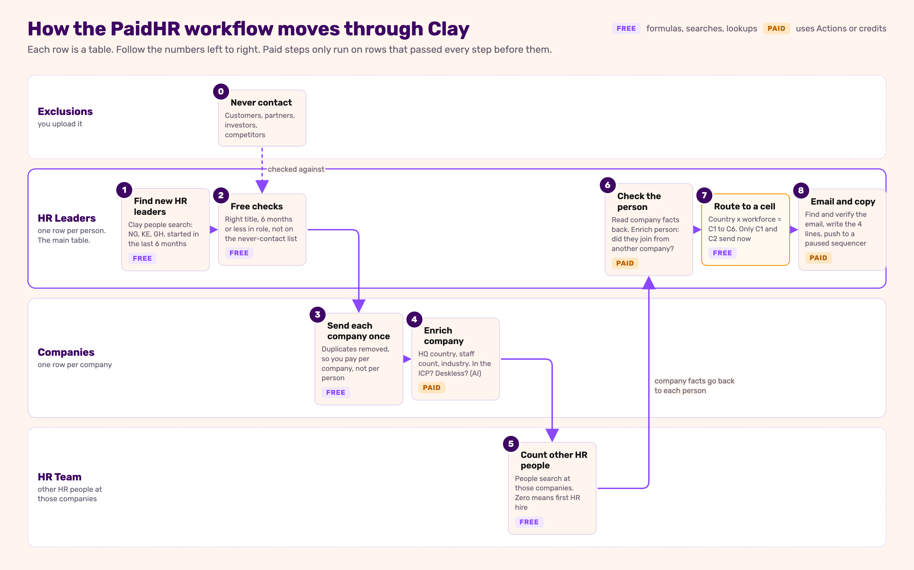

# Clay Build Guide: New HR Leader, First 6 Months (PaidHR)

A step-by-step guide to building `workflow-spec.md` (in this folder) in Clay. Written for someone who has never built anything in Clay. Follow the parts in order. Each step tells you **why** it exists, **what to click**, **what to type**, **how to check it worked** and **what it costs**.

> **Don't skip the checks.** The most common Clay mistake is running a column on 500 rows before checking it worked on 1. Every step below ends with a check. If the check fails, fix it before moving on.

---

## Contents

- [What you are building](#what-you-are-building)
- [Clay words you need](#clay-words-you-need)
- [Before you start](#before-you-start)
- [Part 0. Set up the workbook](#part-0-set-up-the-workbook)
- [Part 1. Exclusions table](#part-1-exclusions-table)
- [Part 2. Find the new HR leaders](#part-2-find-the-new-hr-leaders)
- [Part 3. Free gates on each person](#part-3-free-gates-on-each-person)
- [Part 4. Companies table](#part-4-companies-table)
- [Part 5. HR Team table (is this their first HR hire?)](#part-5-hr-team-table)
- [Part 6. Bring company facts back to each person](#part-6-bring-company-facts-back-to-each-person)
- [Part 7. Check the person](#part-7-check-the-person)
- [Part 8. Route each person to a cell](#part-8-route-each-person-to-a-cell)
- [Part 9. Find and verify the work email](#part-9-find-and-verify-the-work-email)
- [Part 10. Write the email lines](#part-10-write-the-email-lines)
- [Part 11. Views for the operator](#part-11-views-for-the-operator)
- [Part 12. Connect the sequencer (build it, don't run it)](#part-12-connect-the-sequencer)
- [What it costs](#what-it-costs)
- [Final checklist](#final-checklist)
- [When something goes wrong](#when-something-goes-wrong)
- [Things the spec needs to fix](#things-the-spec-needs-to-fix)

---

## What you are building

The spec says: find HR or People leaders in Nigeria, Kenya or Ghana who **joined their company from somewhere else in the last 6 months**, check their company fits, sort them into one of 6 "cells" (country x type of workforce), find their email, and write a personalised Email 1 for the two Nigerian cells.

You will build **4 tables** inside **1 workbook**:



Each row of the picture is a table. The numbers are the order you build in. Step 0 is the list you upload first.

Why this shape:
- **People first**, because the trigger is something that happened to a person (they started a new job).
- **Company checks happen once per company** in their own table. If 3 people at one company show up, you pay to enrich that company once, not three times.
- **Everything paid runs last**, and only on rows that passed every free check before it.

What a finished row in **HR Leaders** looks like, reading left to right:

| Person | Title | Company | Started | Country | Workforce | First HR hire? | Joined from | Cell | Send? | Email | Line 1 … Line 4 |
|---|---|---|---|---|---|---|---|---|---|---|---|
| Ada O. | Head of People | Acme Logistics | 2026-08 | NG | deskless | No | Kobo360 | C1 | Yes | ada@acme… | You joined the HR team at Acme… |

---

## Clay words you need

| Word | What it means |
|---|---|
| **Workbook** | A folder of tables for one campaign. |
| **Table** | A spreadsheet. One row per company or per person. |
| **Source** | Where a table's rows come from (a Clay search, a CSV, another table). |
| **Column** | One piece of information per row. Three kinds matter: **plain** (you type or import it), **formula** (Clay calculates it, free), **enrichment / action** (Clay calls a data provider or AI, usually costs). |
| **Formula** | A small calculation, like a spreadsheet formula. Free. Clay has an AI helper: describe what you want in plain English and it writes the formula for you. |
| **Enrichment** | A column that looks something up (company size, a person's past jobs, an email). Costs **Actions**, and sometimes **Data Credits**. |
| **Lookup** | A column that reads a matching row from another table in your workbook. Free. |
| **Send table data** | A column that copies rows from this table into another table. Free. |
| **Run condition** ("Only run if") | A rule on a paid column: it only runs on rows where the rule is true. This is how you avoid paying for rows you'll throw away. |
| **Auto-run** | When on, new columns run on every row by themselves. **Keep it off** while building. |
| **Actions** | Clay's main usage meter. About 1 Action per enrichment per row. Unused Actions expire monthly. |
| **Data Credits** | A second meter, used when Clay pays a data provider for you (for example, email finders). |
| **View** | A saved filter on a table, like "only rows ready to send". |

---

## Before you start

Tick these off **before** the session. None of them should be done live.

- [ ] **Clay account** with access to the workspace you'll build in. Note which plan it's on (Settings → Plans & billing). You need enough Actions for roughly: number of companies + number of people + email lookups. See [What it costs](#what-it-costs).
- [ ] **Email finder connections** (Settings → Connections), if you'll use your own provider keys (for example Prospeo). Without your own keys, Clay uses its own and charges Data Credits.
- [ ] **The spec is open** next to you: `output/campaigns/new-hr-leader-180-days/workflow-spec.md`. Sections 2 (who's in and out), 4 (signals), 5 (cells) and 6 (variables) are what you're building.
- [ ] **The Exclusions CSV** is ready (Part 1 shows exactly what goes in it).
- [ ] **Decide the test size.** For a live demo, import **25 people**. You can always import more later.

---

## Part 0. Set up the workbook

**Why:** one place for everything in this campaign, so anyone can find it and follow it.

1. In Clay, click **+ New** (top left) → **Workbook**.
2. Name it: `PaidHR · New HR Leader (6 months)`.
3. In the workbook description, paste: *"Signal: HR/People leaders in NG, KE, GH who joined from another company in the last 6 months. Spec: paidhr-gtm-os/output/campaigns/new-hr-leader-180-days/workflow-spec.md. Only cells C1 and C2 send."*

**Check:** the workbook appears in your Clay home with that name.
**Cost:** free.

---

## Part 1. Exclusions table

**Why:** the spec (section 2, Exclude) lists companies we must never email: PaidHR's own customers, partners, investors and competitors. We put them in one table so every other table can check against it.

### 1.1 Make the CSV

Create a spreadsheet with **3 columns** and save it as `exclusions.csv`:

| Company Name | Domain | Type |
|---|---|---|
| Famasi | | Customer |
| Heroshe | | Customer |
| Transport Services Limited | | Customer |
| Oando | | Customer |
| Flutterwave | | Customer |
| Risevest | | Customer |
| MAX | | Customer |
| Dantata | | Customer |
| Bamboo | | Customer |
| Busha | | Customer |
| Nikky Taurus | | Customer |
| FairMoney MFB | | Partner or investor |
| YALO | | Partner or investor |
| FUNDiT | | Partner or investor |
| Sync Capital | | Partner or investor |
| Yield MFB | | Partner or investor |
| Raenest | | Partner or investor |
| RemoFirst | | Partner or investor |
| Zitra | | Partner or investor |
| LSETF | | Partner or investor |
| Accion | | Partner or investor |
| SeamlessHR | | Competitor |
| Workpay | | Competitor |
| Soft Alliance | | Competitor |
| SystemSpecs | | Competitor |
| Bujeti | | Competitor |
| Salario | | Competitor |
| Paypaxe | | Competitor |
| Xceed365HR | | Competitor |
| Deel | | Competitor |
| Remote | | Competitor |
| Oyster | | Competitor |
| Cadana | | Competitor |
| Bento Africa | | Competitor |
| Pluspeople Kenya | | Competitor |
| FaidiHR | | Competitor |
| PayRollGH | | Competitor |

**Domain** is how every other table matches against this list, so fill it in for every row. Type it plain, the way Clay shows domains: `flutterwave.com`. No `https://`, no `www.`, no slash at the end. Find each one on the company's LinkedIn page or website, and check it's the company's own site, not a product or country subdomain.

> **Why domain and not name:** names clash. "Bamboo", "MAX" and "Remote" are also names of unrelated companies, and the same company can appear as "Oando", "Oando PLC" or "Oando Energy". A domain belongs to one company.

> When PaidHR sends its real customer and CRM lists (spec "Open items" 1), add them to this same CSV and re-upload.

### 1.2 Upload it

1. Inside the workbook, click **+ Add table** → **Import CSV**.
2. Upload `exclusions.csv`. Name the table `Exclusions`.

**Check:** 37 rows, 3 columns.
**Cost:** free.

---

## Part 2. Find the new HR leaders

**Why:** this is the trigger (spec section 1). Clay's people search can filter by job title, country, company size, industry **and when they started the job**, all in one search. Searching and importing is **free**. You only pay later when you enrich.

### 2.1 Start a people search

1. In the workbook, click **+ Add table** → **Find people**.
2. You'll see a filter panel on the left and a preview of matching people on the right.

### 2.2 Set the filters

Fill in each filter exactly as below. These come straight from spec section 2.

| Filter | Set it to | Why |
|---|---|---|
| **Job title: include** (current job) | Head of HR · Head of Human Resources · HR Manager · Human Resources Manager · HR & Admin Manager · Head of People · Head of People & Culture · People Lead · People Operations Manager · People Operations Lead · HR Director · Director of Human Resources · Chief People Officer · CHRO · HR Lead | The 15 trigger titles |
| **Job title: exclude** | Assistant · Intern · Coordinator · Recruit · Talent · Learning · L&D · Payroll | Junior or specialist roles. Leave out "Officer" and "Executive" here, because they would also remove "Chief People Officer". We handle them with a formula in Part 3. |
| **Person location: country** | Nigeria · Kenya · Ghana | The person must be in one of the three countries |
| **Company size** | 11-50 · 51-200 · 201-500 · 501-1,000 | Spec says 10 to 1,000. Clay's size buckets start at 11-50, so this is the closest match. |
| **Company industry: exclude** | Staffing and Recruiting · Human Resources Services · Non-profit Organizations · International Affairs · Government Administration | Recruiters, HR consultancies, NGOs and government are out |
| **Started current role** (may be called "Time in current role" or "Job start date") | Within the last **6 months** | The heart of the trigger. If your search panel doesn't show this filter, skip it: Part 3 has a free formula that does the same job. |

### 2.3 Check the numbers before importing

Look at the **total count** above the preview. Write it down. Then change the country filter to one country at a time and write each count down too.

| Country | Count |
|---|---|
| Nigeria | ___ |
| Kenya | ___ |
| Ghana | ___ |

**Why this matters:** this is the "volume check" the spec asks for, and it's free. If Nigeria shows 12 people, you know the campaign is small before you spend anything. LinkedIn data in West and East Africa is thinner than in the US, so expect lower numbers than you'd guess.

Put all three countries back before importing.

### 2.4 Import

1. Set the import **limit to 25** (for the demo; more later).
2. Click **Import** (or **Save to table**). Name the table `HR Leaders`.
3. **Turn Auto-run OFF**: open the table's settings (the ⚙ or "…" menu at the top of the table) → find **Auto-update / Auto-run** → off. Do this before adding any column.

### 2.5 Add the two hidden fields

The search knows each person's **company domain** (e.g. `acme.com`) and the **month they started** (e.g. `2026-08`), but doesn't always show them as columns.

1. Click any cell in the first column (the search source column). A panel opens showing everything the search returned for that person.
2. Find the company domain (inside the matched job, under company → domain). Click it → **Add as column**. Rename the column `Company Domain`.
3. Find the start date (inside the matched job → start_date). **Add as column**. Rename it `Start Date`.
4. Change `Company Domain`'s type to **URL** (column header → Edit column → Data type).

### 2.6 Remove duplicates

Table settings → **Deduplicate** → choose `LinkedIn Profile`. If one person appears twice, Clay keeps one.

**Check:** 25 rows. Each row has a name, job title, company, LinkedIn Profile, Company Domain and Start Date. Open 3 LinkedIn profiles and confirm they really are HR leaders who started recently.
**Cost:** free.

---

## Part 3. Free gates on each person

**Why:** drop the rows we know are wrong **before** spending anything. All three columns here are formulas (free).

**How to add a formula column:** click **+ Add column** (right end of the table) → **Formula**. You can type the formula, or click **Use AI** inside the formula box and describe it in plain English. When the formula refers to another column, type `/` and pick the column from the list. Below, columns are written as `{{Column Name}}`.

### 3.1 `Title OK?`

Catches "HR Officer" and "HR Executive" but keeps "Chief People Officer".

- Plain English for the AI helper: *"True if the job title does NOT contain officer or executive, unless it also contains chief or director."*
- Formula:
```javascript
!((/officer/i.test({{Job Title}}) || /executive/i.test({{Job Title}})) && !/chief|director/i.test({{Job Title}}))
```
**Check:** "HR Officer" → false. "Chief People Officer" → true. "Head of People" → true.

### 3.2 `Months in Role`

Only needed if you couldn't use the start-date filter in Part 2. Add it anyway: it's useful to see.

- Plain English: *"Number of whole months between Start Date (format YYYY-MM) and today."*
- Formula:
```javascript
{{Start Date}} ? (new Date().getFullYear() - Number({{Start Date}}.slice(0, 4))) * 12 + (new Date().getMonth() + 1 - Number({{Start Date}}.slice(5, 7))) : null
```
**Check:** someone who started `2026-08` shows 3 (in November 2026).

### 3.3 `Exclusion Match` (lookup)

1. **+ Add column** → search for **Lookup single row in other table**.
2. Table: `Exclusions`. Match column in Exclusions: `Domain`. Value from this table: `{{Company Domain}}`.
3. Save, then **run it on all rows** (lookups are free).

**Check:** temporarily add a row to `Exclusions` with the domain of one company in your HR Leaders table. Its `Exclusion Match` should fill in. Then delete the test row.

### 3.4 `Pass Person Gates?`

- Plain English: *"True if Title OK is true, Months in Role is 6 or less, and Exclusion Match found nothing."*
- Formula:
```javascript
{{Title OK?}} === true && ({{Months in Role}} === null || {{Months in Role}} <= 6) && !{{Exclusion Match}}
```

**Check:** sort by `Pass Person Gates?`. Open the "false" rows and make sure each one deserves to be out. If a good row is false, fix the formula, not the row.
**Cost:** free.

---

## Part 4. Companies table

**Why:** company facts (where it's headquartered, how many staff, what industry) are checked **once per company**. That's cheaper and cleaner than enriching the same company for every person.

### 4.1 Create the empty table

1. **+ Add table** → **Blank table**. Name it `Companies`.
2. Add two text columns: `Company Domain` (type URL) and `Company Name`.
3. Table settings → **Deduplicate** → choose `Company Domain`. Now, if two HR leaders work at the same company, the company appears only once.
4. Turn **Auto-run off** here too.

### 4.2 Send companies over from HR Leaders

Back in `HR Leaders`:

1. **+ Add column** → **Send table data** (sometimes listed as "Write to table").
2. Destination table: `Companies`.
3. Map: `Company Domain` → `{{Company Domain}}`, `Company Name` → `{{Company}}`.
4. **Run condition** ("Only run if"): `{{Pass Person Gates?}} === true`. This means rows that failed Part 3 never reach Companies.
5. Run it on **1 row** first. Open `Companies` and check the company arrived with the right domain.
6. Then run on all rows.

**Check:** `Companies` has fewer rows than `HR Leaders` (some people share a company) and no duplicates.
**Cost:** free.

### 4.3 Enrich each company

In `Companies`:

1. **+ Add column** → **Enrich Company** (Clay's company enrichment). Input: `{{Company Domain}}`.
2. Run it on **1 row only**. Click the cell and read what came back.
3. From that cell, **Add as column** for: headquarters **country**, **employee count**, **industry** and the company **description** (the "About" text). Rename them `HQ Country`, `Employees`, `Industry`, `Description`.
4. Check the 1 row against the company's LinkedIn page. Right country? Right size?
5. If yes, run on the rest.

**Cost:** about **1 Action per company**. This is the first paid step.

### 4.4 Company formulas (free)

| Column | Plain English for the AI helper | Formula |
|---|---|---|
| `Country Code` | NG for Nigeria, KE for Kenya, GH for Ghana, blank otherwise | `({"Nigeria": "NG", "Kenya": "KE", "Ghana": "GH"})[{{HQ Country}}] \|\| ""` |
| `ICP Pass?` | HQ is in NG, KE or GH, and 10 to 1,000 employees | `["NG","KE","GH"].includes({{Country Code}}) && {{Employees}} >= 10 && {{Employees}} <= 1000` |

> Why `Country Code` comes from the **HQ** and not from the search: the search in Part 2 matches a company if it has **any** office in the three countries. A London company with a Lagos office would slip through. The HQ check catches it.

**Check:** pick 3 companies and confirm `Country Code` and `ICP Pass?` by eye.
**Cost:** free.

### 4.5 Workforce type and plain industry (AI)

**Why AI and not a formula:** "deskless" is about **how the staff work**, not the industry label on LinkedIn. A "Retail" e-commerce startup can be all laptops. A "Financial Services" microfinance bank can have hundreds of field agents. A logistics company often calls itself "Software Development" on LinkedIn. A formula on the industry label would put all three in the wrong cell, and the cell decides which email they get.

You'll build two AI columns: a cheap one that reads what Enrich Company already returned, and a web-browsing one that only runs when the cheap one can't decide.

#### 4.5a `Workforce (AI)`: Use AI

1. **+ Add column** → **Use AI**.
2. Prompt:
   > *You are classifying how a company's staff mostly work.*
   >
   > *Company: {{Company Name}} ({{Company Domain}}). LinkedIn industry: {{Industry}}. Employees: {{Employees}}. Description: {{Description}}*
   >
   > *1. workforce: "deskless" if most staff work away from a desk: on sites, shifts, in the field, in stores, warehouses, vehicles, clinics, farms or factories. "office" if most staff work at a desk or on a laptop. "unclear" if the description doesn't say enough to tell. Don't guess from the industry name alone.*
   >
   > *2. industry_plain: what the company does, in 1 to 3 everyday lowercase words that would fit in the sentence "With ___ teams usually on sites and shifts". Examples: "logistics", "pharmacy delivery", "construction". No company names.*
   >
   > *3. evidence: one short quote or fact from the description that supports your answer. Empty if unclear.*
3. Output format: **JSON**, with exactly these fields:
   - `workforce`: text, must be one of `deskless`, `office`, `unclear`
   - `industry_plain`: text
   - `evidence`: text
4. **Run condition:** `{{ICP Pass?}} === true`. Don't pay to classify companies that already failed.
5. Run on **3 companies you can judge yourself**: one obviously deskless (a logistics or manufacturing firm), one obviously office (a fintech), one in between (a retailer). Read each answer and its evidence. If one is wrong, fix the prompt and re-run the same 3.
6. Then run on the rest.

#### 4.5b `Workforce (web)`: Claygent, only when 4.5a can't decide

1. **+ Add column** → **Claygent**.
2. Same prompt as 4.5a, with this line added at the start: *"Visit {{Company Domain}}, mainly the About, Careers and Locations pages, and base your answer on what you find there."*
3. Same JSON output format as 4.5a.
4. **Run condition:** `{{ICP Pass?}} === true && ({{Workforce (AI)}}?.workforce === "unclear" || !{{Description}})`. Browsing costs more, so it only runs where the cheap column couldn't tell.
5. Run on **1 row**, read the answer against the website yourself, then the rest.

#### 4.5c The two columns the rest of the build uses (free formulas)

These are formulas so they can travel to `HR Leaders` through the lookup in Part 6 (only formula columns cross a lookup cleanly).

| Column | Plain English | Formula |
|---|---|---|
| `Deskless?` | True if the web answer says deskless, or if there's no web answer and the AI answer says deskless | `({{Workforce (web)}}?.workforce \|\| {{Workforce (AI)}}?.workforce) === "deskless"` |
| `Industry Plain` | The plain industry from whichever answer was used, falling back to the LinkedIn industry in lowercase | `{{Workforce (web)}}?.industry_plain \|\| {{Workforce (AI)}}?.industry_plain \|\| ({{Industry}} \|\| "").toLowerCase()` |

> **"unclear" counts as office.** If neither column can tell, `Deskless?` is false and the person goes to C2 (the tax-law email), which is true for every Nigerian employer. Sending the field-staff email (C1) to an office company would be wrong; sending the tax-law email to a deskless one is merely less sharp.

**Check:** filter `Deskless? = true` and read the `evidence` for each. Would you agree with every one?
**Cost:** Use AI about **1 Action plus a small AI cost per ICP-pass company**. Claygent costs more per row, but only runs on the unclear ones.


---

## Part 5. HR Team table

**Why:** Email 1's first line changes if the new leader is the company's **first HR hire** (spec Signal 4). To know that, we count the other HR people at each company. Searching is free.

1. In `Companies`, create a view called `ICP pass` (view dropdown at the top of the table → **+ New view**) with one filter: `ICP Pass?` = true.
2. **+ Add table** → **Find people**. At the top of the filters, choose to find people **at companies from a table** (may be called "Companies from table" or "Search companies in a table"). Pick table `Companies`, view `ICP pass`. Then set:
   > **Why a view and not pasted domains:** the search stays tied to the view, so it's always searching exactly the companies that passed. Pasted domains are a snapshot: companies that qualify later never get searched.
   - **Job title: include**: HR · Human Resources · People · Talent · Payroll · Recruit (any HR-type title, junior ones included).
3. Import. Name the table `HR Team`. Add `Company Domain` as a column the same way as Part 2.5.
4. Back in `Companies`: **+ Add column** → **Lookup multiple rows in other table** → table `HR Team`, match `Company Domain` = `{{Company Domain}}`. Name it `HR People Found`.
5. Formula `HR Team Count`: *"number of rows found in HR People Found, minus 1 for the new leader themselves"*:
```javascript
Math.max(({{HR People Found}}?.length || 0) - 1, 0)
```
6. Formula `First HR Hire?`: `{{HR Team Count}} === 0`

**Check:** pick one company, open its LinkedIn "People" page, search "HR". Does the count roughly match?
**Cost:** free.

> LinkedIn undercounts small Nigerian companies. A "first HR hire" result means "we found no one else", which is why the email says "as far as I can tell".

---

## Part 6. Bring company facts back to each person

In `HR Leaders`:

1. **+ Add column** → **Lookup single row in other table** → table `Companies`, match `Company Domain` = `{{Company Domain}}`. Name it `Company Facts`.
2. From one cell, **Add as column**: `Country Code`, `ICP Pass?`, `Deskless?`, `Industry Plain`, `First HR Hire?`.

**Check:** a person at a company you checked in Part 4 shows the same values.
**Cost:** free.

---

## Part 7. Check the person

### 7.1 Find where they worked before (`Enrich Person`)

**Why:** the spec only wants leaders who **joined from another company** (no internal promotions), and Email 1 names their previous company.

1. **+ Add column** → **Enrich Person** (from LinkedIn profile). Input: `{{LinkedIn Profile}}`.
2. **Run condition:** `{{Pass Person Gates?}} === true && {{ICP Pass?}} === true`. Don't pay to enrich people at companies that already failed.
3. Run on **1 row**. Open the cell and find the **list of past jobs** (often called `experience` or `experiences`). Note which field holds the company name and which holds the company domain or LinkedIn URL.

### 7.2 `Previous Company` and `Previous Domain`

Use the AI formula helper. Plain English: *"From the Enrich Person result, take the most recent job that is not the current job. Return its company name."* Then the same for its domain.

The formula will look roughly like this. **The field names depend on what your Enrich Person cell shows, so let the AI helper write it from the real cell:**
```javascript
{{Enrich Person}}?.experience?.find(e => !e.is_current)?.company_name || ""
```

### 7.3 `Joined From Outside?`

- Plain English: *"True if Previous Company is not empty and Previous Domain is different from Company Domain."*
```javascript
!!{{Previous Company}} && {{Previous Domain}} !== {{Company Domain}}
```

### 7.4 `Champion Move?` (parked, not sent)

The spec says: if their previous employer is a PaidHR customer, that's a different campaign ("champion migration").

1. **Lookup single row in other table** → `Exclusions`, match `Domain` = `{{Previous Domain}}`. Name it `Previous Employer Match`.
2. Check one row: if `Previous Domain` is blank, this lookup can't work, so fix 7.2 first.
3. Formula `Champion Move?`: *"true if Previous Employer Match found a row whose Type is Customer"*.

### 7.5 `Still Employed?` (optional but recommended)

**Why:** search data can lag. One AI check confirms they still hold the job before you email them.

1. **+ Add column** → **Use AI**.
2. Prompt:
   > *"Here is a person's work history: {{Enrich Person}}. Are they currently employed at the company with domain {{Company Domain}} as {{Job Title}} or a similar HR leadership title? Answer YES, NO or REVIEW (REVIEW if the evidence is unclear)."*
3. Output format: **JSON**, with one field `response` that can only be `YES`, `NO` or `REVIEW`.
4. **Run condition:** `{{Joined From Outside?}} === true && {{Champion Move?}} !== true`
5. Run on **2 rows**, read both answers against LinkedIn, then the rest.

**Cost:** Enrich Person about **1 Action per person**. Use AI about **1 Action plus a small AI cost per person**.

---

## Part 8. Route each person to a cell

### 8.1 `Cell`

The spec's 6 cells are country x workforce type.

- Plain English: *"C1 if Nigeria and deskless, C2 if Nigeria and not deskless, C3 if Kenya and deskless, C4 if Kenya and not, C5 if Ghana and deskless, C6 if Ghana and not."*
```javascript
({"NG": {{Deskless?}} ? "C1" : "C2", "KE": {{Deskless?}} ? "C3" : "C4", "GH": {{Deskless?}} ? "C5" : "C6"})[{{Country Code}}] || ""
```

### 8.2 `Ready to Contact?`

Every check from the spec in one column. Only rows with **true** get an email lookup and copy.

- Plain English: *"True if all of these are true: Pass Person Gates, ICP Pass, Joined From Outside, Champion Move is not true, Still Employed is YES (or blank if you skipped 7.5), and Cell is C1 or C2."*
```javascript
{{Pass Person Gates?}} === true && {{ICP Pass?}} === true && {{Joined From Outside?}} === true && {{Champion Move?}} !== true && ({{Still Employed?}}?.response === "YES" || !{{Still Employed?}}) && ["C1", "C2"].includes({{Cell}})
```

> Kenya (C3, C4) and Ghana (C5, C6) rows stay in the table with their cell filled in, but `Ready to Contact?` is false. That's the spec's "build, don't send" rule until PaidHR confirms it supports payroll in those countries.

**Check:** filter `Ready to Contact? = true`. Open every row. Would you be happy for each of these people to get the email?
**Cost:** free.

---

## Part 9. Find and verify the work email

**Why:** we only look up emails for people we will actually contact. This is usually the most expensive step.

1. **+ Add column** → **Find work email** (Clay's email **waterfall**: it tries several providers in order until one finds an email).
2. Inputs: full name `{{Full Name}}`, company domain `{{Company Domain}}`, LinkedIn `{{LinkedIn Profile}}`.
3. Providers: put any you've connected with your own key first (for example Prospeo), then Clay's. **4 providers is enough.**
4. Turn on **validation** inside the waterfall (each email found is checked before it's accepted). Choose the strict setting: **don't accept "catch-all" or "risky"**.
5. **Run condition:** `{{Ready to Contact?}} === true`.
6. Run on **1 row**. Read the result: an email, plus a status such as "valid".
7. Then run on the rest of the `Ready to Contact?` rows.
8. From the waterfall, **Add as column**: `Work Email` (type Email) and `Email Status`.

**Check:** every row with an email has status valid. Rows with no email stay in the table but won't be sent.
**Cost:** Actions plus Data Credits **for each provider step that actually runs**. A row found by the first provider costs less than one that goes through all four.

---

## Part 10. Write the email lines

**Why:** the spec's Email 1 is built from lines, and each line changes depending on the row. Because every version is already written and approved (spec "Copy" section), **these are formulas, not AI**. Free, and identical every time.

Add these columns in `HR Leaders`. Each one only needs to work on `Ready to Contact?` rows.

### 10.1 Helper variables

| Column | Plain English | Formula |
|---|---|---|
| `Company Short` | Company name without Ltd, Limited, PLC | `({{Company}} \|\| "").replace(/\s+(ltd\|limited\|plc)\.?$/i, "").trim()` |
| `Start Month` | Month name of Start Date, e.g. "August" | `["January","February","March","April","May","June","July","August","September","October","November","December"][Number(({{Start Date}} \|\| "").slice(5, 7)) - 1] \|\| ""` |
| `Return Window?` | True from 1 Nov to 31 Jan (annual PAYE return season) | `[11, 12, 1].includes(new Date().getMonth() + 1)` |

### 10.2 Email 1 lines

Each line is a formula column. For every one, the **plain English** is the description: paste it into the formula's **Use AI** helper so Clay writes the formula, and keep it as the column's description so anyone reading the table knows what the line does. Then compare what Clay wrote with the formula below.

Every line starts with `{{Ready to Contact?}} ? … : ""`, so rows that won't be emailed stay blank. The wording inside the quotes is copied **exactly** from the spec's Copy section. Don't edit it here: change the spec first, then the formula.

#### `E1 L1`: the opener (routes on First HR Hire?)

- **Plain English:** *"If Ready to Contact is false, leave blank. If First HR Hire is true, write: You joined [Company Short] from [Previous Company] as its first HR hire, as far as I can tell, so you're likely still mapping how payroll works there. Otherwise write: You joined the HR team at [Company Short] from [Previous Company] in [Start Month], so you're probably still getting to know how payroll runs there."*
- **Formula:**
```javascript
!{{Ready to Contact?}} ? "" :
{{First HR Hire?}}
  ? "You joined " + {{Company Short}} + " from " + {{Previous Company}} + " as its first HR hire, as far as I can tell, so you're likely still mapping how payroll works there."
  : "You joined the HR team at " + {{Company Short}} + " from " + {{Previous Company}} + " in " + {{Start Month}} + ", so you're probably still getting to know how payroll runs there."
```
- **Check:** one row with First HR Hire true and one with false. Company, previous company and month all read naturally, nothing blank.

#### `E1 L2`: the situation (routes on Cell)

- **Plain English:** *"If Ready to Contact is false, leave blank. If Cell is C1, write: With [Industry Plain] teams usually on sites and shifts, that includes people who rarely sit at a desk, casual staff too. If Cell is C2, write: And the 2026 tax rules changed how rent relief, bonuses and gratuity go through payroll."*
- **Formula:**
```javascript
!{{Ready to Contact?}} ? "" :
{{Cell}} === "C1"
  ? "With " + {{Industry Plain}} + " teams usually on sites and shifts, that includes people who rarely sit at a desk, casual staff too."
  : "And the 2026 tax rules changed how rent relief, bonuses and gratuity go through payroll."
```
- **Check:** a C1 row reads "With logistics teams…" (or whatever its plain industry is), not "With truck transportation teams…". If the industry word sounds wrong, fix `Industry Plain` in Part 4.5, not this line.

#### `E1 L3`: the value prop (routes on Cell)

- **Plain English:** *"If Ready to Contact is false, leave blank. If Cell is C1, write: PaidHR runs payroll, PAYE and pension for every one of them, and site staff get payslips, leave and earned wages on WhatsApp or USSD, no app needed. If Cell is C2, write: PaidHR is fully updated for Nigeria's new tax law, effective 1 January 2026, and remits PAYE and pension for you."*
- **Formula:**
```javascript
!{{Ready to Contact?}} ? "" :
{{Cell}} === "C1"
  ? "PaidHR runs payroll, PAYE and pension for every one of them, and site staff get payslips, leave and earned wages on WhatsApp or USSD, no app needed."
  : "PaidHR is fully updated for Nigeria's new tax law, effective 1 January 2026, and remits PAYE and pension for you."
```
- **Check:** C1 rows mention site staff, C2 rows mention the tax law.

#### `E1 L4`: the social proof (routes on Cell)

- **Plain English:** *"If Ready to Contact is false, leave blank. If Cell is C1, write: Heroshe, a cross-border shipping business, moved its statutory remittances onto PaidHR and got a receipt for each payment. If Cell is C2, write: Across its customers, that came to ₦934M PAYE and ₦754M pension remitted in 2025 with zero defaults and zero delays."*
- **Formula:**
```javascript
!{{Ready to Contact?}} ? "" :
{{Cell}} === "C1"
  ? "Heroshe, a cross-border shipping business, moved its statutory remittances onto PaidHR and got a receipt for each payment."
  : "Across its customers, that came to ₦934M PAYE and ₦754M pension remitted in 2025 with zero defaults and zero delays."
```
- **Check:** the ₦ sign shows correctly in the cell (copy it from the spec rather than typing it).

#### Read the whole email

Pick one C1 row and one C2 row. Paste their L1 to L4 into a document in order, with the greeting above and the CTA below, and read each email out loud. If any line sounds wrong for that person, find which column produced it and fix that column.

> **Spintax stays in the sequencer, not in Clay.** The subject line, CTA and sign-off have options like `{Best,|Thanks,}`. Put those directly in the sequencer template. Sequencers don't process spintax that arrives inside a Clay variable.

**Check:** pick one C1 row and one C2 row. Paste their four lines together in a document and read the email out loud. Does every name, company and month read naturally? Is anything blank?
**Cost:** free.

---

## Part 11. Views for the operator

**Why:** someone opening this table later should see what matters without understanding every column.

In `HR Leaders`, create these views (**+ View** or the view dropdown at the top → add a filter):

| View | Filter | Who uses it |
|---|---|---|
| `Ready to send` | `Ready to Contact?` = true AND `Email Status` = valid | The person loading the sequencer |
| `Held: Kenya and Ghana` | `Cell` is C3, C4, C5 or C6 | Waiting on PaidHR confirmation |
| `Parked: champion moves` | `Champion Move?` = true | A future campaign |
| `Dropped` | `Pass Person Gates?` = false OR `ICP Pass?` = false | Spot-checking the gates |

In the `Ready to send` view, hide helper formulas (Months in Role, HR People Found…) and keep: name, title, company, cell, email, E1 L1 to L4. **Don't hide paid columns or lookups**: they show where the data came from.

---

## Part 12. Connect the sequencer

**Build this column, but don't run it.** The spec is not sendable yet (facts not approved by PaidHR, Seye hasn't agreed to be the sender, no suppression lists).

1. In the sequencer (Smartlead, Instantly or Clay's own sequencer), create a campaign called `PaidHR · New HR Leader · E1`, and **leave it paused**. Put the subject, greeting, `{{e1l1}}` to `{{e1l4}}`, CTA and sign-off in its template, using the spec's Copy section.
2. In `HR Leaders`: **+ Add column** → the sequencer's "Add lead to campaign" action.
3. Map: email `{{Work Email}}`, first name, company `{{Company Short}}`, and custom fields `e1l1` to `e1l4` → the four line columns.
4. **Run condition:** `{{Ready to Contact?}} === true && {{Email Status}} === "valid"`.
5. **Stop.** On launch day, run it on 1 row, check the lead appears correctly in the paused campaign, then run the rest.

**Cost:** about **1 Action per lead pushed**. The emails themselves cost nothing in Clay.

---

## What it costs

Free: the search, imports, formulas, lookups, Send table data, views.

Paid, and only on rows that passed every check before it:

| Step | Runs on | Rough cost |
|---|---|---|
| Enrich Company (4.3) | Each company that passed person gates | 1 Action per company |
| Workforce (AI) (4.5a) | ICP-pass companies | 1 Action + a small AI cost per company |
| Workforce (web) Claygent (4.5b) | Only companies the AI marked unclear | More per company than Use AI (browses pages) |
| Enrich Person (7.1) | People at ICP-pass companies | 1 Action per person |
| Still Employed? (7.5) | People who joined from outside | 1 Action + a small AI cost per person |
| Email waterfall (9) | `Ready to Contact?` rows only | Actions + Data Credits per provider step that runs |
| Sequencer push (12) | Valid emails only | 1 Action per lead |

**Example for the 25-person demo:** say 18 people pass Part 3 at 15 companies, 12 are at ICP-pass companies, 10 joined from outside, 6 are C1 or C2. Say 10 ICP-pass companies, 2 of them unclear. That's about 15 (Enrich Company) + 10 (Workforce AI) + 2 (Claygent) + 12 (Enrich Person) + 10 (Still Employed) + (6 x up to 4 waterfall steps) ≈ **55 to 75 Actions**, plus a few Data Credits for emails.

Watch the Actions counter (top of Clay) before and after each paid step, and write the numbers down. That's your real cost per row.

---

## Final checklist

- [ ] Auto-run is **off** on every table.
- [ ] Every paid column has a **run condition**.
- [ ] Every paid column was tested on **1 row** and the cell was read before running more.
- [ ] `Companies` has no duplicate domains.
- [ ] No company from `Exclusions` appears in `Ready to send`.
- [ ] No Kenya or Ghana row is `Ready to Contact?`.
- [ ] Two sample emails (one C1, one C2) were read out loud and make sense.
- [ ] Sequencer campaign exists, **paused**, push column built and **not run**.
- [ ] Actions spent are written down per step.

---

## When something goes wrong

| What you see | Likely cause | Fix |
|---|---|---|
| Search shows 0 people | A filter is too strict (often the start-date filter or a misspelt title) | Remove filters one at a time to find which one empties it |
| Thousands of people from everywhere | The country or start-date filter didn't apply | Re-check filters before importing; use the Part 3 formula gate |
| A column ran on every row and spent Actions | Auto-run was on, or no run condition | Turn auto-run off; add the run condition; you can't get Actions back, so note the spend |
| Formula shows an error | A column name changed, or a value is blank | Re-pick the column with `/`; guard blanks with `|| ""` |
| Lookup finds nothing | The two domains are written differently (`www.acme.com` vs `acme.com`, `https://acme.com/` vs `acme.com`) | Compare the two values side by side. Retype the Exclusions domain plain, or add a formula that strips `https://`, `www.` and the trailing `/` before matching |
| Previous Company is blank | The person's LinkedIn has one job only, or the field name in your formula is wrong | Open the Enrich Person cell and point the formula at the real field |
| Email status is "catch-all" or "risky" | The company's mail server accepts everything | Leave it out. Don't send to unverified emails |
| Sent the same company twice to Companies | Deduplicate wasn't set before the first send | Set dedupe on `Company Domain`, then delete the duplicates |

---

## Things the spec needs to fix

Found while writing this guide. Update `workflow-spec.md`:

1. **Section 3, "Before the build":** the volume check is a **free** search preview, not a paid call.
2. **Section 2, title exclusions:** "Officer" and "Executive" would remove "Chief People Officer", which is an included title. Exclude them only when the title doesn't also contain "Chief" or "Director" (done in Part 3.1).
3. **Section 2, headcount floor:** Clay's company size buckets start at 11-50, so the real floor is 11, not 10.
4. **Section 4, Signal 1:** start dates come as year and month, so "180 days" is applied as "6 months or less".
5. **Section 4, Signal 3 (deskless):** change the read from "LinkedIn industry is one of 8 labels" to "AI classification of how most staff work, from the company description (Claygent on the website if unclear), output `deskless` / `office` / `unclear`, unclear counts as office". The industry label misclassifies too many companies to route copy on.
6. **Copy re-check (still open in the spec):** headcount now goes up to 1,000, but the Heroshe and Famasi proof lines and Email 3's "the founder" were written for small companies.
